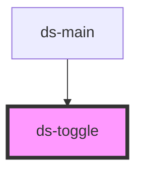

# ds-toggle

<!-- Auto Generated Below -->

## Overview

A radio, checkbox, switch or icon toggle. A click checks a radio (it cannot be unchecked by a click)
and checks or unchecks the other types; each change emits `toggle` with `{ name, value, checked }`.

## Properties

| Property   | Attribute  | Description                                                                                                                                                                   | Type                          | Default     |
| ---------- | ---------- | ----------------------------------------------------------------------------------------------------------------------------------------------------------------------------- | ----------------------------- | ----------- |
| `checked`  | `checked`  |                                                                                                                                                                               | `boolean`                     | `undefined` |
| `disabled` | `disabled` |                                                                                                                                                                               | `boolean`                     | `undefined` |
| `mods`     | `mods`     | Comma-separated list (or array) of modifiers, rendered as `--<modifier>` classes on the component.                                                                            | `string \| string[]`          | `[]`        |
| `name`     | `name`     |                                                                                                                                                                               | `string`                      | `undefined` |
| `type`     | `type`     | `radio`, `checkbox`, `switch` or `icon`. Without it, the toggle uses the type its parent gives with `setType()` (`ds-toggle-group`), else `switch`: its own type always wins. | `string`                      | `undefined` |
| `value`    | `value`    |                                                                                                                                                                               | `boolean \| number \| string` | `undefined` |

## Events

| Event    | Description | Type               |
| -------- | ----------- | ------------------ |
| `toggle` |             | `CustomEvent<any>` |

## Methods

### `setChecked(checked: boolean) => Promise<void>`

#### Parameters

| Name      | Type      | Description |
| --------- | --------- | ----------- |
| `checked` | `boolean` |             |

#### Returns

Type: `Promise<void>`

### `setName(name: string) => Promise<void>`

#### Parameters

| Name   | Type     | Description |
| ------ | -------- | ----------- |
| `name` | `string` |             |

#### Returns

Type: `Promise<void>`

### `setProps(properties: Record<string, unknown>) => Promise<void>`

Sets the given props (`mods`, `value`, `name`, `type`, `disabled`, `checked`); `undefined` values and other keys are ignored.

#### Parameters

| Name         | Type                        | Description |
| ------------ | --------------------------- | ----------- |
| `properties` | `{ [x: string]: unknown; }` |             |

#### Returns

Type: `Promise<void>`

### `setType(type: "radio" | "icon" | "checkbox" | "switch" | string) => Promise<void>`

Sets the type given by a parent (`ds-toggle-group` calls it): the toggle uses it while it has no `type` of
its own. `undefined` removes it.

#### Parameters

| Name   | Type     | Description |
| ------ | -------- | ----------- |
| `type` | `string` |             |

#### Returns

Type: `Promise<void>`

## Dependencies

### Used by

 - [ds-main](../../demo)

### Graph

----------------------------------------------

*Built with [StencilJS](https://stenciljs.com/)*
