# ds-trigger

<!-- Auto Generated Below -->

## Properties

| Property   | Attribute  | Description | Type                              | Default     |
| ---------- | ---------- | ----------- | --------------------------------- | ----------- |
| `action`   | `action`   |             | `string`                          | `undefined` |
| `disabled` | `disabled` |             | `boolean`                         | `false`     |
| `mods`     | `mods`     |             | `string \| string[]`              | `[]`        |
| `on`       | `on`       |             | `string`                          | `undefined` |
| `target`   | `target`   |             | `string`                          | `undefined` |
| `type`     | `type`     |             | `"button" \| "control" \| "link"` | `'control'` |

## Dependencies

### Used by

 - [ds-app-menu](../../pronto/app-menu)
 - [ds-back-to-top-button](../../pronto/back-to-top-button)
 - [ds-block-builder](../../pronto/pronto-content/configurator/block-builder)
 - [ds-checkout-page](../../pronto/checkout/checkout-page)
 - [ds-feature-configurator](../../pronto/pronto-content/configurator/features)
 - [ds-features-configurator](../../pronto/pronto-content/configurator/features)
 - [ds-html](../../pronto/pronto-content/configurator/html)
 - [ds-html-editor](../../pronto/pronto-content/form)
 - [ds-input-date](../../pronto/pronto-content/form)
 - [ds-input-modal](../../pronto/pronto-content/form)
 - [ds-input-number](../../input-number)
 - [ds-main-configurator](../../pronto/pronto-content/configurator/main)
 - [ds-marquee-configurator](../../pronto/pronto-content/configurator/marquee)
 - [ds-media](../../pronto/pronto-content/configurator/media)
 - [ds-message](../../ui/message)
 - [ds-modal](../../ui/modal)
 - [ds-nav-item](../../pronto/nav/nav-item)
 - [ds-panel-configurator](../../pronto/pronto-content/configurator/panels)
 - [ds-panels-configurator](../../pronto/pronto-content/configurator/panels)
 - [ds-password](../../pronto/password)
 - [ds-product-block](../../pronto/product-block)
 - [ds-search](../../search)
 - [ds-slider](../../ui/slider)
 - [ds-tag](../../pronto/pronto-content/search)
 - [pronto-content-admin](../../pronto/pronto-content)
 - [pronto-field](../../pronto/pronto-content/form)
 - [pronto-product-list](../../pronto/pronto-content/configurator/product-list)

### Graph

```mermaid
graph TD;
  ds-app-menu --> ds-trigger
  ds-back-to-top-button --> ds-trigger
  ds-block-builder --> ds-trigger
  ds-checkout-page --> ds-trigger
  ds-feature-configurator --> ds-trigger
  ds-features-configurator --> ds-trigger
  ds-html --> ds-trigger
  ds-html-editor --> ds-trigger
  ds-input-date --> ds-trigger
  ds-input-modal --> ds-trigger
  ds-input-number --> ds-trigger
  ds-main-configurator --> ds-trigger
  ds-marquee-configurator --> ds-trigger
  ds-media --> ds-trigger
  ds-message --> ds-trigger
  ds-modal --> ds-trigger
  ds-nav-item --> ds-trigger
  ds-panel-configurator --> ds-trigger
  ds-panels-configurator --> ds-trigger
  ds-password --> ds-trigger
  ds-product-block --> ds-trigger
  ds-search --> ds-trigger
  ds-slider --> ds-trigger
  ds-tag --> ds-trigger
  pronto-content-admin --> ds-trigger
  pronto-field --> ds-trigger
  pronto-product-list --> ds-trigger
  style ds-trigger fill:#f9f,stroke:#333,stroke-width:4px
```

----------------------------------------------

*Built with [StencilJS](https://stenciljs.com/)*
