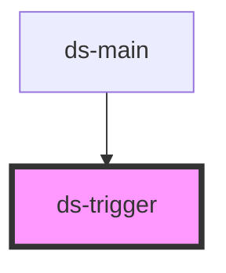

# ds-trigger

<!-- Auto Generated Below -->

## Properties

| Property   | Attribute  | Description | Type                              | Default     |
| ---------- | ---------- | ----------- | --------------------------------- | ----------- |
| `action`   | `action`   |             | `string`                          | `undefined` |
| `disabled` | `disabled` |             | `boolean`                         | `false`     |
| `mods`     | `mods`     |             | `string \| string[]`              | `[]`        |
| `on`       | `on`       |             | `string`                          | `'click'`   |
| `target`   | `target`   |             | `string`                          | `undefined` |
| `type`     | `type`     |             | `"button" \| "control" \| "link"` | `'control'` |

## Dependencies

### Used by

 - [ds-main](../..)

### Graph

----------------------------------------------

*Built with [StencilJS](https://stenciljs.com/)*
