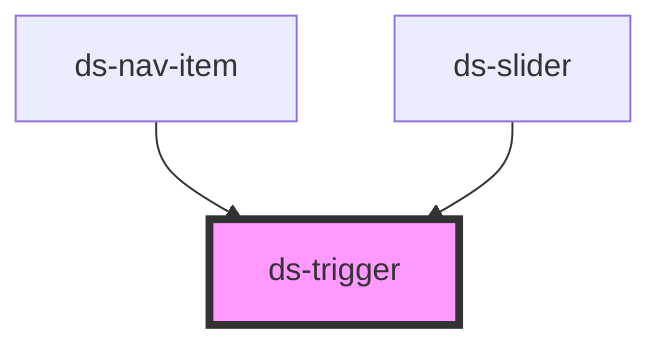

# ds-trigger

## Styling

- **Classes**: `ds-<type>` on `<ds-trigger>`: `ds-control` (the default type, without a skin), `ds-button` (`type="button"`) or `ds-link` (`type="link"`); `mods` → `--<mod>`.
- **Modifiers** of a button in the default theme: the sizes `--xs`, `--sm`, `--md` (the default), `--lg`, `--xl`; the colors `--stl-1` (solid primary), `--stl-2` (outlined secondary), `--stl-3` (solid gray; without any, solid gray); `--rounded`; `--shadow`. Other skins add variants: `--menu-item` (the expand button of `ds-nav-item`), `--slider` (the buttons of `ds-slider`).
- **Attributes** (reflected): `disabled` (a dimmed button, with a not-allowed cursor), `action`, `on`, `mods`.
- **Slots**: the default slot, the content of the trigger.
- **Structure** (`trigger.scss`): an inline block, vertically centered, without padding or margin. A direct `a`, `button`, `span`, `strong` or `div` child is an inline block that inherits the text and colors of the trigger.
- **Look** (default theme, `components/_trigger.scss`): the button (font, size, colors, border, radius, hover colors) and the link (color, hover color), from the custom properties below. The default theme sets them on `ds-trigger`; the size, color and `rounded` modifiers and the hover set them again on the button. An override on `ds-trigger` changes the button without modifiers: to change a modifier, override it on its selector.

Override them after the theme stylesheet (see [Styling a component](../../../README.md#styling-a-component)):

```css
ds-trigger {
  --ds-trigger-radius: 0;
  --ds-trigger-link-color: var(--ds-color-secondary-base);
}

.ds-button.--stl-1:not([disabled]):hover {
  --ds-trigger-background: var(--ds-color-primary-darker);
  --ds-trigger-border-color: var(--ds-color-primary-darker);
}
```

<!-- Auto Generated Below -->


## Overview

Calls a method of a target element on an event: `<ds-trigger target="#slider" action="next">`.
`action` is the method name, optionally followed by JSON arguments: `action='goTo:[2]'`.

## Properties

| Property   | Attribute  | Description                                                                                        | Type                              | Default     |
| ---------- | ---------- | -------------------------------------------------------------------------------------------------- | --------------------------------- | ----------- |
| `action`   | `action`   | Method of the target to call, optionally followed by its JSON arguments (`goTo:[2]`).              | `string`                          | `undefined` |
| `disabled` | `disabled` | A disabled trigger does not call the action.                                                       | `boolean`                         | `false`     |
| `mods`     | `mods`     | Comma-separated list (or array) of modifiers, rendered as `--<modifier>` classes on the component. | `string \| string[]`              | `[]`        |
| `on`       | `on`       | Event of the trigger that calls the action.                                                        | `string`                          | `'click'`   |
| `target`   | `target`   | The target: a CSS selector, `window` or `document`.                                                | `string`                          | `undefined` |
| `type`     | `type`     |                                                                                                    | `"button" \| "control" \| "link"` | `'control'` |


## Slots

| Slot | Description      |
| ---- | ---------------- |
|      | The default slot |


## CSS Custom Properties

| Name                            | Description                                                                           |
| ------------------------------- | ------------------------------------------------------------------------------------- |
| `--ds-trigger-background`       | Background of a button. The `stl-*` modifiers and the hover set it.                   |
| `--ds-trigger-border-color`     | Border color of a button. The `stl-*` modifiers and the hover set it.                 |
| `--ds-trigger-color`            | Text color of a button (`type="button"`). The `stl-*` modifiers and the hover set it. |
| `--ds-trigger-font-size`        | Font size of a button. The size modifiers (`xs` to `xl`) set it.                      |
| `--ds-trigger-link-color`       | Text color of a link (`type="link"`).                                                 |
| `--ds-trigger-link-hover-color` | Text color of a hovered link.                                                         |
| `--ds-trigger-padding`          | Padding of a button. The size modifiers (`xs` to `xl`) set it.                        |
| `--ds-trigger-radius`           | Corner radius of a button. The `rounded` modifier sets it.                            |


## Dependencies

### Used by

 - [ds-nav-item](../nav/nav-item)
 - [ds-slider](../slider)

### Graph


----------------------------------------------

*Built with [StencilJS](https://stenciljs.com/)*
