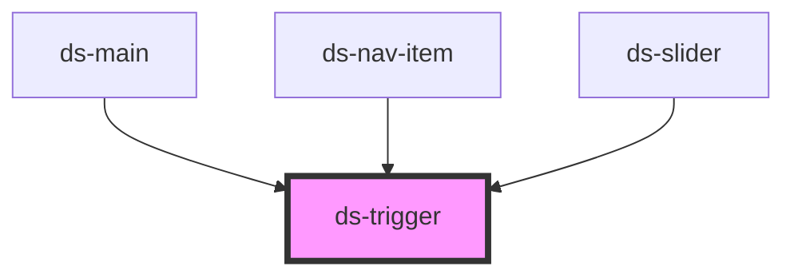

# ds-trigger

<!-- Auto Generated Below -->

## Overview

Calls a method of a target element on an event: `<ds-trigger target="#slider" action="next">`.
`action` is the method name, optionally followed by JSON arguments: `action='goTo:[2]'`.

## Properties

| Property   | Attribute  | Description                                                                                        | Type                              | Default     |
| ---------- | ---------- | -------------------------------------------------------------------------------------------------- | --------------------------------- | ----------- |
| `action`   | `action`   | Method of the target to call, optionally followed by its JSON arguments (`goTo:[2]`).              | `string`                          | `undefined` |
| `disabled` | `disabled` | A disabled trigger does not call the action.                                                       | `boolean`                         | `false`     |
| `mods`     | `mods`     | Comma-separated list (or array) of modifiers, rendered as `--<modifier>` classes on the component. | `string \| string[]`              | `[]`        |
| `on`       | `on`       | Event of the trigger that calls the action.                                                        | `string`                          | `'click'`   |
| `target`   | `target`   | The target: a CSS selector, `window` or `document`.                                                | `string`                          | `undefined` |
| `type`     | `type`     |                                                                                                    | `"button" \| "control" \| "link"` | `'control'` |

## Dependencies

### Used by

 - [ds-main](../../demo)
 - [ds-nav-item](../nav/nav-item)
 - [ds-slider](../slider)

### Graph

----------------------------------------------

*Built with [StencilJS](https://stenciljs.com/)*
