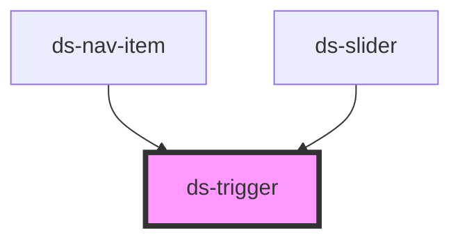

# ds-trigger

## Styling

- **Classes**: `ds-<type>` on `<ds-trigger>`: `ds-control` (the default type, without a skin), `ds-button` (`type="button"`) or `ds-link` (`type="link"`); `mods` → `--<mod>`.
- **Modifiers** of a button in the default theme: the sizes `--xs`, `--sm`, `--md` (the default), `--lg`, `--xl`; the colors `--stl-1` (solid primary), `--stl-2` (outlined secondary), `--stl-3` (solid gray; without any, solid gray); `--rounded`; `--shadow`. Other skins add variants: `--menu-item` (the expand button of `ds-nav-item`), `--slider` (the buttons of `ds-slider`).
- **Attributes** (reflected): `disabled` (a dimmed button, with a not-allowed cursor), `action`, `on`, `mods`.
- **Slots**: the default slot, the content of the trigger.
- **Focus**: when it is the control (see [Accessibility](#accessibility)), the element takes the focus: the outline of the theme (`:focus-visible`) draws around it.
- **Structure** (`trigger.scss`): an inline block, vertically centered, without padding or margin. A direct `a`, `button`, `span`, `strong` or `div` child is an inline block that inherits the text and colors of the trigger.
- **Look** (default theme, `components/_trigger.scss`): the button (font, size, colors, border, radius, hover colors) and the link (color, hover color), from the custom properties below. The default theme sets them on `ds-trigger`; the size, color and `rounded` modifiers and the hover set them again on the button. An override on `ds-trigger` changes the button without modifiers: to change a modifier, override it on its selector.

Override them after the theme stylesheet (see [Styling a component](../../../README.md#styling-a-component)):

```css
ds-trigger {
  --ds-trigger-radius: 0;
  --ds-trigger-link-color: var(--ds-color-secondary-base);
}

.ds-button.--stl-1:not([disabled]):hover {
  --ds-trigger-background: var(--ds-color-primary-darker);
  --ds-trigger-border-color: var(--ds-color-primary-darker);
}
```

## Accessibility

When it is the control, the trigger follows the WAI-ARIA [button pattern](https://www.w3.org/WAI/ARIA/apg/patterns/button/).

- **The control**: a trigger that calls its action on a click (`on="click"`, the default) and whose content has no control of its own is the control. The `<ds-trigger>` element gets `role="button"` (or keeps the `role` it already has: `tab`, `menuitem`, `link`…) and `tabindex="0"`. The three types are buttons, `type` is their look: for a navigation, put a real link in the trigger (`<a href>`).
- **A content with a control of its own**, a link with an `href`, a `button`, a form field, a `summary`, an element with a `tabindex` or `contenteditable`: the trigger adds no role, no `tabindex`, no keys and no `aria-label`. The control keeps its semantics and its keyboard, and its click (from Enter or Space too) calls the action. `disabled` then only stops the action: disable the native control too. The content is checked when the trigger is connected and when it changes (MutationObserver).
- **Another event** (`on="mouseenter"`…): the trigger is not a button (no role, no focus); give the keyboard another way to the action.
- **Keyboard**: Enter clicks the trigger, on keydown; Space clicks it on keyup, as a native button (not with `role="link"`). The click calls the `on="click"` action and the click listeners of the page (and those of `ds-slider` and `ds-nav-item` on their buttons). Space does not scroll the page; a key held down does not repeat; the keys with Alt, Ctrl or Meta are left to the browser.
- **Disabled**: `aria-disabled="true"` and no `tabindex`: it cannot be focused, the keys do nothing and the action is not called (a click still reaches the click listeners of the page).
- **Name** (required): its text; else `label` (`aria-label`), for a trigger without a text (an icon); or `aria-label` / `aria-labelledby` on the element.
- It does not submit a form: use a native `<button>` for that.

```html
<ds-trigger type="button" mods="stl-1" target="#cart" action="show">Cart</ds-trigger>

<ds-trigger type="button" target="#slider" action="next" label="Next slide"><ds-icon type="right" aria-hidden="true"></ds-icon></ds-trigger>

<ds-trigger target="#menu" action="toggle"><button type="button" aria-haspopup="listbox">Menu</button></ds-trigger>
```

**Changed**: the role, `tabindex`, the keyboard, `aria-disabled` and `label` are new: a trigger that is the control is in the Tab order, the previous and next buttons of `ds-slider` and the expand button of `ds-nav-item` too.

<!-- Auto Generated Below -->


## Overview

Calls a method of a target element on an event: `<ds-trigger target="#slider" action="next">`.
`action` is the method name, optionally followed by JSON arguments: `action='goTo:[2]'`.
When it is the control (it calls on `click`, and its content has no link, button or other control of its own), the
element is a button (WAI-ARIA button pattern): `role="button"` (or the `role` it already has), `tabindex="0"`, Enter
and Space click it, and a disabled trigger is `aria-disabled` and cannot be focused. A content with its own control
(a native `button`, a link) keeps its semantics: the trigger adds nothing, and the click of that control calls the action.

## Properties

| Property   | Attribute  | Description                                                                                                            | Type                              | Default     |
| ---------- | ---------- | ---------------------------------------------------------------------------------------------------------------------- | --------------------------------- | ----------- |
| `action`   | `action`   | Method of the target to call, optionally followed by its JSON arguments (`goTo:[2]`).                                  | `string`                          | `undefined` |
| `disabled` | `disabled` | A disabled trigger does not call the action; when it is the control, it is `aria-disabled` and cannot be focused.      | `boolean`                         | `false`     |
| `label`    | `label`    | The accessible name of the trigger (`aria-label`) when it is the control, for a trigger without a text (an icon).      | `string`                          | `undefined` |
| `mods`     | `mods`     | Comma-separated list (or array) of modifiers, rendered as `--<modifier>` classes on the component.                     | `string \| string[]`              | `[]`        |
| `on`       | `on`       | Event of the trigger that calls the action. With another event than `click`, the trigger is not a button.              | `string`                          | `'click'`   |
| `target`   | `target`   | The target: a CSS selector, `window` or `document`.                                                                    | `string`                          | `undefined` |
| `type`     | `type`     | `control` (no skin), `button` (the `.ds-button` skin) or `link` (the `.ds-link` skin): the look only, all are buttons. | `"button" \| "control" \| "link"` | `'control'` |


## Slots

| Slot | Description                                                                                          |
| ---- | ---------------------------------------------------------------------------------------------------- |
|      | The content of the trigger: its text (its name, when it is the control), or a native button or link. |


## CSS Custom Properties

| Name                            | Description                                                                           |
| ------------------------------- | ------------------------------------------------------------------------------------- |
| `--ds-trigger-background`       | Background of a button. The `stl-*` modifiers and the hover set it.                   |
| `--ds-trigger-border-color`     | Border color of a button. The `stl-*` modifiers and the hover set it.                 |
| `--ds-trigger-color`            | Text color of a button (`type="button"`). The `stl-*` modifiers and the hover set it. |
| `--ds-trigger-font-size`        | Font size of a button. The size modifiers (`xs` to `xl`) set it.                      |
| `--ds-trigger-link-color`       | Text color of a link (`type="link"`).                                                 |
| `--ds-trigger-link-hover-color` | Text color of a hovered link.                                                         |
| `--ds-trigger-padding`          | Padding of a button. The size modifiers (`xs` to `xl`) set it.                        |
| `--ds-trigger-radius`           | Corner radius of a button. The `rounded` modifier sets it.                            |


## Dependencies

### Used by

 - [ds-nav-item](../nav/nav-item)
 - [ds-slider](../slider)

### Graph


----------------------------------------------

*Built with [StencilJS](https://stenciljs.com/)*
