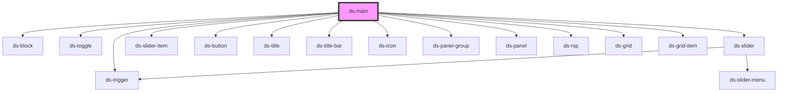

# ds-main

<!-- Auto Generated Below -->

## Methods

### `getData(key: string) => Promise<unknown>`

#### Parameters

| Name  | Type     | Description |
| ----- | -------- | ----------- |
| `key` | `string` |             |

#### Returns

Type: `Promise<unknown>`

## Dependencies

### Depends on

- [ds-block](../core/block)
- [ds-toggle](../core/toggle)
- [ds-slider](../core/slider)
- [ds-slider-item](../core/slider/slider-item)
- [ds-button](../core/button)
- [ds-trigger](../core/trigger)
- [ds-title](../core/title)
- [ds-title-bar](../core/title-bar)
- [ds-icon](../core/icon)
- [ds-panel-group](../core/panel-group)
- [ds-panel](../core/panel)
- [ds-rsp](../core/responsive)
- [ds-grid](../core/grid)
- [ds-grid-item](../core/grid/grid-item)

### Graph

----------------------------------------------

*Built with [StencilJS](https://stenciljs.com/)*
