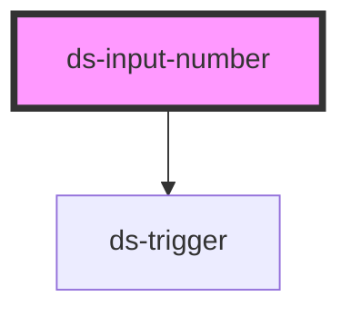

# ds-input-number

<!-- Auto Generated Below -->

## Properties

| Property       | Attribute       | Description | Type               | Default     |
| -------------- | --------------- | ----------- | ------------------ | ----------- |
| `ariaLabel`    | `aria-label`    |             | `string`           | `""`        |
| `defaultValue` | `default-value` |             | `number \| string` | `1`         |
| `max`          | `max`           |             | `number \| string` | `undefined` |
| `min`          | `min`           |             | `number \| string` | `1`         |
| `name`         | `name`          |             | `string`           | `undefined` |

## Events

| Event            | Description | Type               |
| ---------------- | ----------- | ------------------ |
| `quantityChange` |             | `CustomEvent<any>` |

## Methods

### `setValue(value: number) => Promise<void>`

#### Parameters

| Name    | Type     | Description |
| ------- | -------- | ----------- |
| `value` | `number` |             |

#### Returns

Type: `Promise<void>`

## Dependencies

### Depends on

- [ds-trigger](../core/trigger)

### Graph

----------------------------------------------

*Built with [StencilJS](https://stenciljs.com/)*
