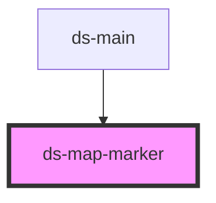

# ds-map-marker

<!-- Auto Generated Below -->

## Properties

| Property | Attribute | Description | Type                                                                                                                                                                                                                         | Default     |
| -------- | --------- | ----------- | ---------------------------------------------------------------------------------------------------------------------------------------------------------------------------------------------------------------------------- | ----------- |
| `icon`   | `icon`    |             | `Icon \| Symbol \| string`                                                                                                                                                                                                   | `undefined` |
| `label`  | `label`   |             | `MarkerLabel \| string`                                                                                                                                                                                                      | `undefined` |
| `lat`    | `lat`     |             | `number`                                                                                                                                                                                                                     | `undefined` |
| `lng`    | `lng`     |             | `number`                                                                                                                                                                                                                     | `undefined` |
| `name`   | `name`    |             | `string`                                                                                                                                                                                                                     | `undefined` |
| `params` | `params`  |             | `string \| { shape?: MarkerShape; draggable?: boolean; cursor?: string; opacity?: number; anchorPoint?: Point; animation?: Animation; clickable?: boolean; crossOnDrag?: boolean; optimized?: boolean; visible?: boolean; }` | `undefined` |

## Dependencies

### Used by

 - [ds-main](../..)

### Graph

----------------------------------------------

*Built with [StencilJS](https://stenciljs.com/)*
