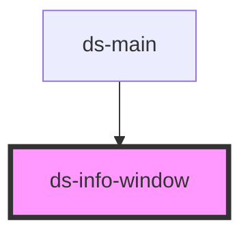

# ds-info-window

<!-- Auto Generated Below -->

## Properties

| Property         | Attribute          | Description                                                                                                                                   | Type                      | Default     |
| ---------------- | ------------------ | --------------------------------------------------------------------------------------------------------------------------------------------- | ------------------------- | ----------- |
| `ariaLabel`      | `aria-label`       | AriaLabel to assign to the InfoWindow.                                                                                                        | `string`                  | `undefined` |
| `disableAutoPan` | `disable-auto-pan` | Disable panning the map to make the InfoWindow fully visible when it opens.                                                                   | `boolean`                 | `false`     |
| `maxWidth`       | `max-width`        | Maximum width of the InfoWindow, regardless of content&#39;s width. This                                                                      | `number`                  | `undefined` |
| `minWidth`       | `min-width`        | Minimum width of the InfoWindow, regardless of the content&#39;s width.                                                                       | `number`                  | `undefined` |
| `pixelOffset`    | --                 | The offset, in pixels, of the tip of the info window from the point on the map at whose geographical coordinates the info window is anchored. | `Size`                    | `undefined` |
| `position`       | --                 | The LatLng at which to display this InfoWindow.                                                                                               | `LatLng \| LatLngLiteral` | `undefined` |
| `zIndex`         | `z-index`          | All InfoWindows are displayed on the map in order of their zIndex, with higher values displaying in front of InfoWindows with lower values.   | `number`                  | `undefined` |

## Methods

### `getParams() => Promise<google.maps.InfoWindowOptions>`

#### Returns

Type: `Promise<InfoWindowOptions>`

## Dependencies

### Used by

 - [ds-main](../..)

### Graph

----------------------------------------------

*Built with [StencilJS](https://stenciljs.com/)*
