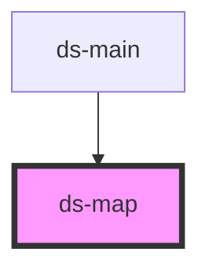

# ds-map-rc

<!-- Auto Generated Below -->

## Properties

| Property    | Attribute   | Description | Type                    | Default     |
| ----------- | ----------- | ----------- | ----------------------- | ----------- |
| `apiKey`    | `api-key`   |             | `string`                | `undefined` |
| `locations` | `locations` |             | `Location[] \| string`  | `undefined` |
| `params`    | `params`    |             | `GMapsParams \| string` | `undefined` |

## Methods

### `addInfoWindow(infoWindowComponent: HTMLDsInfoWindowElement, marker: google.maps.Marker) => Promise<void>`

#### Returns

Type: `Promise<void>`

### `addMapStyle(name: string, styles: google.maps.MapTypeStyle[]) => Promise<void>`

#### Returns

Type: `Promise<void>`

### `addMarkers(markers: MapMarkerOptions[]) => Promise<any[]>`

#### Returns

Type: `Promise<any[]>`

### `clusturize() => Promise<void>`

#### Returns

Type: `Promise<void>`

### `fitMarkers() => Promise<void>`

#### Returns

Type: `Promise<void>`

### `getTilt() => Promise<number>`

#### Returns

Type: `Promise<number>`

### `getZoom() => Promise<number>`

#### Returns

Type: `Promise<number>`

### `initialize(apiKey?: string, initializeCallbackName?: string) => Promise<void>`

#### Returns

Type: `Promise<void>`

### `setMapStyles(name: string) => Promise<void>`

#### Returns

Type: `Promise<void>`

### `setTilt(tilt?: number) => Promise<void>`

#### Returns

Type: `Promise<void>`

### `setZoom(zoomLevel: number) => Promise<void>`

#### Returns

Type: `Promise<void>`

### `zoomIn(scale?: number) => Promise<void>`

#### Returns

Type: `Promise<void>`

### `zoomOut(scale?: number) => Promise<void>`

#### Returns

Type: `Promise<void>`

## Dependencies

### Used by

 - [ds-main](..)

### Graph

----------------------------------------------

*Built with [StencilJS](https://stenciljs.com/)*
