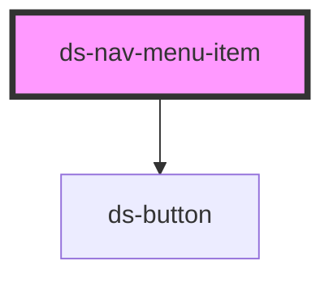

# ds-nav-menu-item

<!-- Auto Generated Below -->

## Properties

| Property      | Attribute      | Description | Type      | Default     |
| ------------- | -------------- | ----------- | --------- | ----------- |
| `depth`       | `depth`        |             | `number`  | `0`         |
| `dsItemId`    | `ds-item-id`   |             | `string`  | `undefined` |
| `hasChildren` | `has-children` |             | `boolean` | `false`     |
| `isActive`    | `is-active`    |             | `boolean` | `false`     |
| `isAnimated`  | `is-animated`  |             | `boolean` | `true`      |
| `type`        | `type`         |             | `string`  | `'page'`    |

## Events

| Event             | Description | Type               |
| ----------------- | ----------- | ------------------ |
| `dsMenuItemClick` |             | `CustomEvent<any>` |

## Dependencies

### Depends on

- [ds-button](../../button)

### Graph

----------------------------------------------

*Built with [StencilJS](https://stenciljs.com/)*
