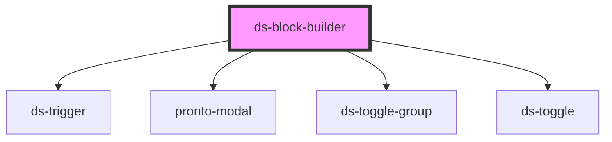

# ds-block-builder

<!-- Auto Generated Below -->

## Properties

| Property   | Attribute  | Description | Type     | Default     |
| ---------- | ---------- | ----------- | -------- | ----------- |
| `name`     | `name`     |             | `string` | `undefined` |
| `settings` | `settings` |             | `any`    | `[]`        |

## Events

| Event               | Description | Type               |
| ------------------- | ----------- | ------------------ |
| `configChange`      |             | `CustomEvent<any>` |
| `saveConfiguration` |             | `CustomEvent<any>` |

## Dependencies

### Depends on

- [ds-trigger](../../../../core/trigger)
- [pronto-modal](../../form/modal)
- [ds-toggle-group](../../../../core/toggle-group)
- [ds-toggle](../../../../core/toggle)

### Graph

----------------------------------------------

*Built with [StencilJS](https://stenciljs.com/)*
