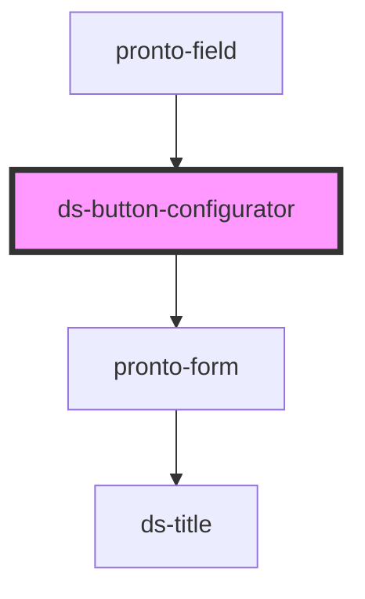

# ds-button-configurator

<!-- Auto Generated Below -->

## Properties

| Property       | Attribute       | Description | Type     | Default             |
| -------------- | --------------- | ----------- | -------- | ------------------- |
| `defaultValue` | `default-value` |             | `any`    | `undefined`         |
| `inputId`      | `input-id`      |             | `string` | `undefined`         |
| `value`        | `value`         |             | `any`    | `emptyButtonConfig` |

## Events

| Event         | Description | Type               |
| ------------- | ----------- | ------------------ |
| `valueChange` |             | `CustomEvent<any>` |

## Methods

### `getConfig(extraProps: any) => Promise<{ config: any; markup: string; }>`

#### Parameters

| Name         | Type  | Description |
| ------------ | ----- | ----------- |
| `extraProps` | `any` |             |

#### Returns

Type: `Promise<{ config: any; markup: string; }>`

## Dependencies

### Used by

 - [pronto-field](../../form)

### Depends on

- [pronto-form](../../form)

### Graph

----------------------------------------------

*Built with [StencilJS](https://stenciljs.com/)*
