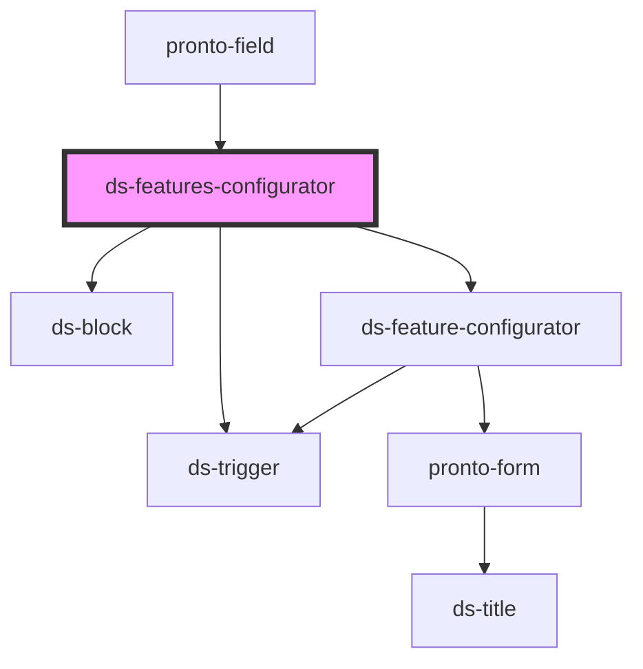

# ds-features-configurator

<!-- Auto Generated Below -->

## Properties

| Property      | Attribute      | Description | Type      | Default     |
| ------------- | -------------- | ----------- | --------- | ----------- |
| `name`        | `name`         |             | `string`  | `undefined` |
| `settings`    | `settings`     |             | `any`     | `[]`        |
| `showActions` | `show-actions` |             | `boolean` | `true`      |

## Events

| Event               | Description | Type               |
| ------------------- | ----------- | ------------------ |
| `configChange`      |             | `CustomEvent<any>` |
| `saveConfiguration` |             | `CustomEvent<any>` |

## Dependencies

### Used by

 - [pronto-field](../../form)

### Depends on

- [ds-block](../../../../core/block)
- [ds-feature-configurator](.)
- [ds-trigger](../../../../core/trigger)

### Graph

----------------------------------------------

*Built with [StencilJS](https://stenciljs.com/)*
