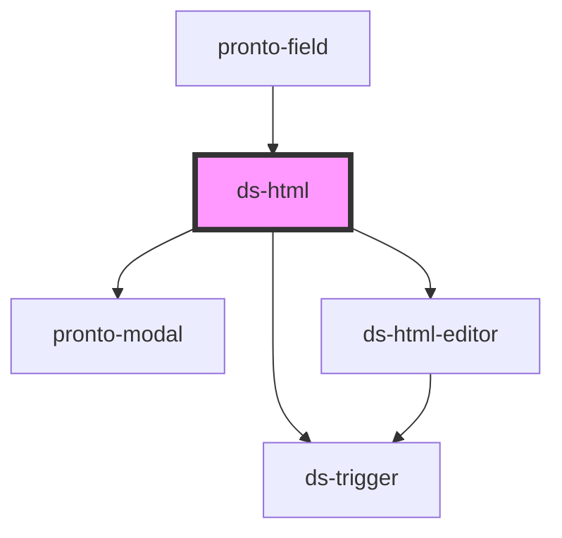

# ds-html

<!-- Auto Generated Below -->

## Properties

| Property | Attribute | Description | Type     | Default     |
| -------- | --------- | ----------- | -------- | ----------- |
| `name`   | `name`    |             | `string` | `undefined` |
| `value`  | `value`   |             | `any`    | `undefined` |

## Events

| Event         | Description | Type               |
| ------------- | ----------- | ------------------ |
| `valueChange` |             | `CustomEvent<any>` |

## Methods

### `hide() => Promise<void>`

#### Returns

Type: `Promise<void>`

### `show() => Promise<void>`

#### Returns

Type: `Promise<void>`

### `toggle(mustShow?: boolean) => Promise<void>`

#### Parameters

| Name       | Type      | Description |
| ---------- | --------- | ----------- |
| `mustShow` | `boolean` |             |

#### Returns

Type: `Promise<void>`

## Dependencies

### Used by

 - [pronto-field](../../form)

### Depends on

- [pronto-modal](../../form/modal)
- [ds-html-editor](../../form)
- [ds-trigger](../../../../core/trigger)

### Graph

----------------------------------------------

*Built with [StencilJS](https://stenciljs.com/)*
