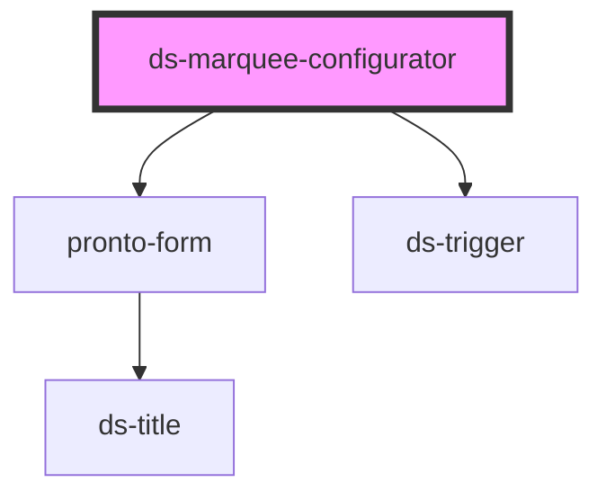

# ds-marquee-configurator

<!-- Auto Generated Below -->

## Properties

| Property   | Attribute  | Description | Type     | Default              |
| ---------- | ---------- | ----------- | -------- | -------------------- |
| `inputId`  | `input-id` |             | `string` | `undefined`          |
| `settings` | `settings` |             | `any`    | `emptyMarqueeConfig` |

## Events

| Event               | Description | Type               |
| ------------------- | ----------- | ------------------ |
| `saveConfiguration` |             | `CustomEvent<any>` |

## Dependencies

### Depends on

- [pronto-form](../../form)
- [ds-trigger](../../../../core/trigger)

### Graph

----------------------------------------------

*Built with [StencilJS](https://stenciljs.com/)*
