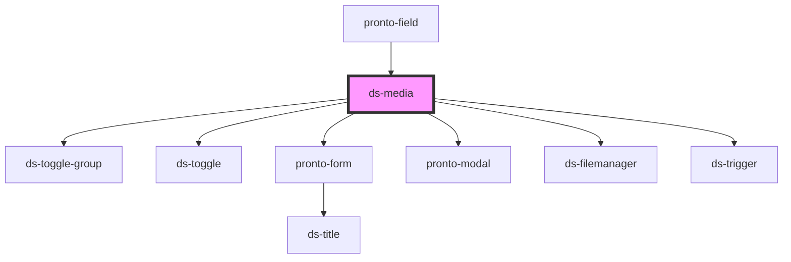

# ds-media

<!-- Auto Generated Below -->

## Properties

| Property          | Attribute          | Description | Type              | Default     |
| ----------------- | ------------------ | ----------- | ----------------- | ----------- |
| `associatedRoute` | `associated-route` |             | `string`          | `undefined` |
| `mediaPositions`  | --                 |             | `MediaPosition[]` | `[]`        |
| `name`            | `name`             |             | `string`          | `undefined` |
| `value`           | `value`            |             | `any`             | `undefined` |

## Events

| Event         | Description | Type               |
| ------------- | ----------- | ------------------ |
| `valueChange` |             | `CustomEvent<any>` |

## Methods

### `getConfig(extraProps: Record<string, unknown>) => Promise<{ config: any; markup: string; }>`

#### Parameters

| Name         | Type                        | Description |
| ------------ | --------------------------- | ----------- |
| `extraProps` | `{ [x: string]: unknown; }` |             |

#### Returns

Type: `Promise<{ config: any; markup: string; }>`

### `hide() => Promise<void>`

#### Returns

Type: `Promise<void>`

### `setAttributes(attributes: any) => Promise<void>`

#### Parameters

| Name         | Type  | Description |
| ------------ | ----- | ----------- |
| `attributes` | `any` |             |

#### Returns

Type: `Promise<void>`

### `setPath(path: string) => Promise<void>`

#### Parameters

| Name   | Type     | Description |
| ------ | -------- | ----------- |
| `path` | `string` |             |

#### Returns

Type: `Promise<void>`

### `setPosition(position: MediaPosition) => Promise<void>`

#### Parameters

| Name       | Type                                                | Description |
| ---------- | --------------------------------------------------- | ----------- |
| `position` | `"top" \| "bottom" \| "left" \| "right" \| "under"` |             |

#### Returns

Type: `Promise<void>`

### `setType(type: MediaType) => Promise<void>`

#### Parameters

| Name   | Type                 | Description |
| ------ | -------------------- | ----------- |
| `type` | `"video" \| "image"` |             |

#### Returns

Type: `Promise<void>`

### `setUrlType(urlType: MediaUrlType) => Promise<void>`

#### Parameters

| Name      | Type                  | Description |
| --------- | --------------------- | ----------- |
| `urlType` | `"local" \| "remote"` |             |

#### Returns

Type: `Promise<void>`

### `show() => Promise<void>`

#### Returns

Type: `Promise<void>`

### `toggle(mustShow?: boolean) => Promise<void>`

#### Parameters

| Name       | Type      | Description |
| ---------- | --------- | ----------- |
| `mustShow` | `boolean` |             |

#### Returns

Type: `Promise<void>`

## Dependencies

### Used by

 - [pronto-field](../../form)

### Depends on

- [ds-toggle-group](../../../../core/toggle-group)
- [ds-toggle](../../../../core/toggle)
- [pronto-form](../../form)
- [pronto-modal](../../form/modal)
- [ds-filemanager](../../form)
- [ds-trigger](../../../../core/trigger)

### Graph

----------------------------------------------

*Built with [StencilJS](https://stenciljs.com/)*
