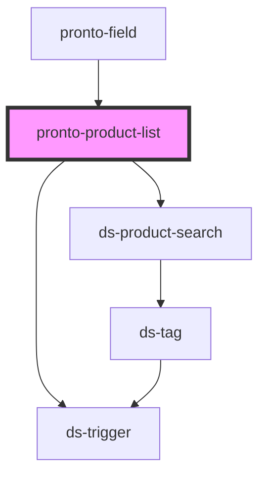

# pronto-product-list

<!-- Auto Generated Below -->

## Properties

| Property          | Attribute          | Description | Type     | Default     |
| ----------------- | ------------------ | ----------- | -------- | ----------- |
| `associatedRoute` | `associated-route` |             | `string` | `undefined` |
| `inputProps`      | `input-props`      |             | `any`    | `undefined` |
| `value`           | --                 |             | `any[]`  | `[]`        |

## Events

| Event         | Description | Type               |
| ------------- | ----------- | ------------------ |
| `valueChange` |             | `CustomEvent<any>` |

## Dependencies

### Used by

 - [pronto-field](../../form)

### Depends on

- [ds-product-search](../../search/product)
- [ds-trigger](../../../../core/trigger)

### Graph

----------------------------------------------

*Built with [StencilJS](https://stenciljs.com/)*
