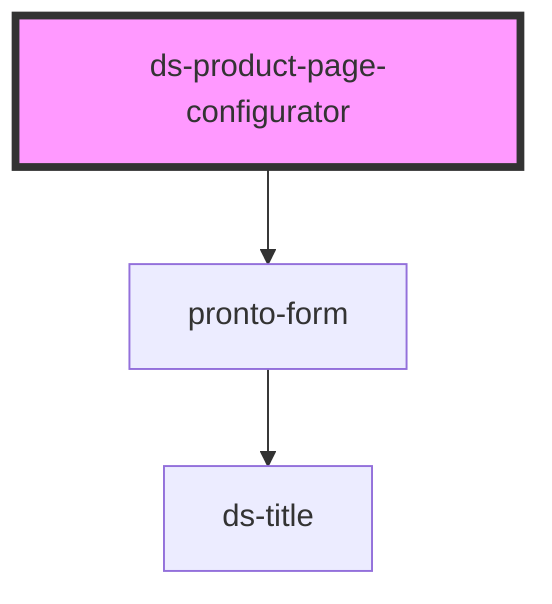

# ds-product-page-configurator

<!-- Auto Generated Below -->

## Properties

| Property       | Attribute       | Description | Type     | Default     |
| -------------- | --------------- | ----------- | -------- | ----------- |
| `defaultValue` | `default-value` |             | `string` | `undefined` |
| `settings`     | `settings`      |             | `any`    | `{}`        |

## Events

| Event               | Description | Type               |
| ------------------- | ----------- | ------------------ |
| `configChange`      |             | `CustomEvent<any>` |
| `preview`           |             | `CustomEvent<any>` |
| `saveConfiguration` |             | `CustomEvent<any>` |

## Methods

### `getConfig(extraProps?: Record<string, any>) => Promise<{ markup: string; config: Record<string, unknown>; }>`

#### Parameters

| Name         | Type                    | Description |
| ------------ | ----------------------- | ----------- |
| `extraProps` | `{ [x: string]: any; }` |             |

#### Returns

Type: `Promise<{ markup: string; config: Record<string, unknown>; }>`

## Dependencies

### Depends on

- [pronto-form](../../form)

### Graph

----------------------------------------------

*Built with [StencilJS](https://stenciljs.com/)*
