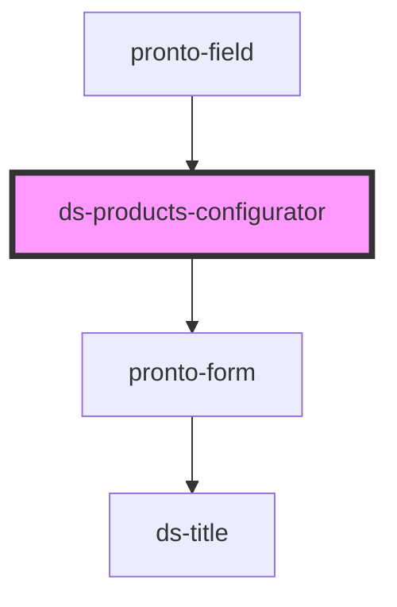

# ds-products-configurator

<!-- Auto Generated Below -->

## Properties

| Property          | Attribute          | Description | Type     | Default     |
| ----------------- | ------------------ | ----------- | -------- | ----------- |
| `associatedRoute` | `associated-route` |             | `string` | `undefined` |
| `defaultValue`    | `default-value`    |             | `string` | `undefined` |
| `settings`        | `settings`         |             | `any`    | `{}`        |

## Events

| Event          | Description | Type               |
| -------------- | ----------- | ------------------ |
| `configChange` |             | `CustomEvent<any>` |

## Dependencies

### Used by

 - [pronto-field](../../form)

### Depends on

- [pronto-form](../../form)

### Graph

----------------------------------------------

*Built with [StencilJS](https://stenciljs.com/)*
