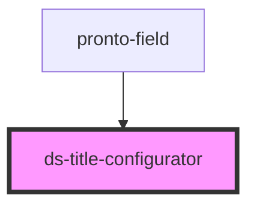

# ds-title-configurator

<!-- Auto Generated Below -->

## Properties

| Property        | Attribute        | Description | Type     | Default                                   |
| --------------- | ---------------- | ----------- | -------- | ----------------------------------------- |
| `toolbar`       | `toolbar`        |             | `string` | `'h1 h2 h3 h4 h5 bold'`                   |
| `validElements` | `valid-elements` |             | `string` | `'h1,h2,h3,h4,h5,strong,em,span,a[href]'` |
| `value`         | `value`          |             | `string` | `undefined`                               |

## Events

| Event         | Description | Type               |
| ------------- | ----------- | ------------------ |
| `valueChange` |             | `CustomEvent<any>` |

## Dependencies

### Used by

 - [pronto-field](../../form)

### Graph

----------------------------------------------

*Built with [StencilJS](https://stenciljs.com/)*
