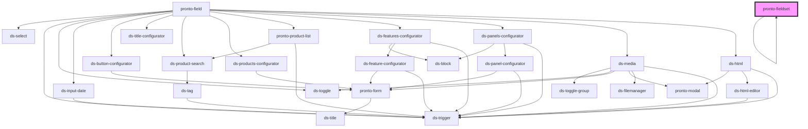

# pronto-fieldset

<!-- Auto Generated Below -->

## Properties

| Property       | Attribute       | Description | Type     | Default     |
| -------------- | --------------- | ----------- | -------- | ----------- |
| `defaultValue` | `default-value` |             | `any`    | `undefined` |
| `depth`        | `depth`         |             | `number` | `0`         |
| `fields`       | --              |             | `any[]`  | `[]`        |
| `label`        | `label`         |             | `string` | `""`        |
| `name`         | `name`          |             | `string` | `""`        |

## Events

| Event         | Description | Type               |
| ------------- | ----------- | ------------------ |
| `valueChange` |             | `CustomEvent<any>` |

## Dependencies

### Used by

 - [pronto-fieldset](.)

### Depends on

- [ds-title](../../../../core/title)
- [pronto-fieldset](.)
- [pronto-field](..)

### Graph

----------------------------------------------

*Built with [StencilJS](https://stenciljs.com/)*
