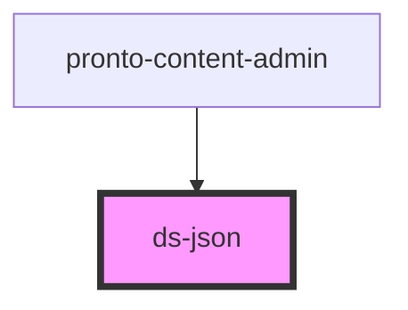

# ds-json

<!-- Auto Generated Below -->

## Properties

| Property | Attribute | Description | Type  | Default |
| -------- | --------- | ----------- | ----- | ------- |
| `data`   | `data`    |             | `any` | `{}`    |

## Dependencies

### Used by

 - [pronto-content-admin](../..)

### Graph

----------------------------------------------

*Built with [StencilJS](https://stenciljs.com/)*
