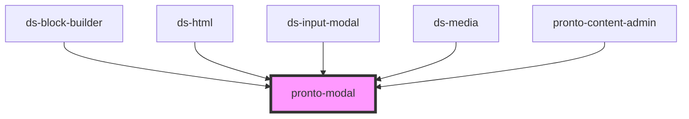

# ds-modal

<!-- Auto Generated Below -->

## Properties

| Property          | Attribute          | Description | Type                 | Default     |
| ----------------- | ------------------ | ----------- | -------------------- | ----------- |
| `associatedRoute` | `associated-route` |             | `string`             | `undefined` |
| `mods`            | `mods`             |             | `string \| string[]` | `[]`        |
| `name`            | `name`             |             | `string`             | `undefined` |
| `overlay`         | `overlay`          |             | `boolean`            | `false`     |
| `type`            | `type`             |             | `string`             | `undefined` |
| `value`           | `value`            |             | `any`                | `undefined` |

## Events

| Event        | Description | Type               |
| ------------ | ----------- | ------------------ |
| `modalClose` |             | `CustomEvent<any>` |
| `modalOpen`  |             | `CustomEvent<any>` |

## Dependencies

### Used by

 - [ds-block-builder](../../configurator/block-builder)
 - [ds-html](../../configurator/html)
 - [ds-input-modal](..)
 - [ds-media](../../configurator/media)
 - [pronto-content-admin](../..)

### Graph

----------------------------------------------

*Built with [StencilJS](https://stenciljs.com/)*
