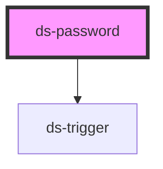

# ds-password

<!-- Auto Generated Below -->

## Properties

| Property       | Attribute       | Description | Type                   | Default      |
| -------------- | --------------- | ----------- | ---------------------- | ------------ |
| `defaultValue` | `default-value` |             | `string`               | `''`         |
| `mods`         | `mods`          |             | `string \| string[]`   | `[]`         |
| `name`         | `name`          |             | `string`               | `undefined`  |
| `pattern`      | `pattern`       |             | `string`               | `undefined`  |
| `type`         | `type`          |             | `"password" \| "text"` | `'password'` |

## Dependencies

### Depends on

- [ds-trigger](../../core/trigger)

### Graph

----------------------------------------------

*Built with [StencilJS](https://stenciljs.com/)*
