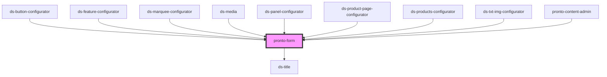

# pronto-form

<!-- Auto Generated Below -->

## Properties

| Property | Attribute | Description | Type                           | Default     |
| -------- | --------- | ----------- | ------------------------------ | ----------- |
| `fields` | --        |             | `any[]`                        | `[]`        |
| `mods`   | `mods`    |             | `string \| string[]`           | `[]`        |
| `size`   | `size`    |             | `"lg" \| "md" \| "sm" \| "xl"` | `undefined` |

## Events

| Event         | Description | Type               |
| ------------- | ----------- | ------------------ |
| `valueChange` |             | `CustomEvent<any>` |

## Dependencies

### Used by

 - [ds-button-configurator](../configurator/button)
 - [ds-feature-configurator](../configurator/features)
 - [ds-marquee-configurator](../configurator/marquee)
 - [ds-media](../configurator/media)
 - [ds-panel-configurator](../configurator/panels)
 - [ds-product-page-configurator](../configurator/product-page)
 - [ds-products-configurator](../configurator/products-block)
 - [ds-txt-img-configurator](../configurator/text-image)
 - [pronto-content-admin](..)

### Depends on

- [ds-title](../../../core/title)

### Graph

----------------------------------------------

*Built with [StencilJS](https://stenciljs.com/)*
