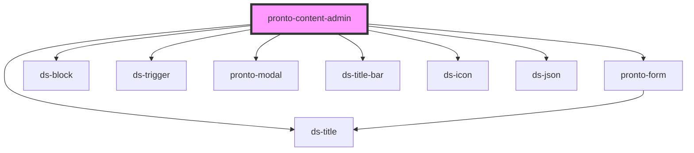

# pronto-content-admin

<!-- Auto Generated Below -->

## Properties

| Property         | Attribute         | Description | Type                | Default     |
| ---------------- | ----------------- | ----------- | ------------------- | ----------- |
| `active`         | `active`          |             | `boolean \| string` | `undefined` |
| `adminUrl`       | `admin-url`       |             | `string`            | `undefined` |
| `blockTitle`     | `block-title`     |             | `string`            | `''`        |
| `componentType`  | `component-type`  |             | `string`            | `''`        |
| `controllerUrl`  | `controller-url`  |             | `string`            | `undefined` |
| `endDate`        | `end-date`        |             | `string`            | `undefined` |
| `filemanagerUrl` | `filemanager-url` |             | `string`            | `undefined` |
| `hook`           | `hook`            |             | `string`            | `''`        |
| `linkedId`       | `linked-id`       |             | `string`            | `''`        |
| `modifiers`      | `modifiers`       |             | `string`            | `undefined` |
| `orderPosition`  | `order-position`  |             | `string`            | `undefined` |
| `pageType`       | `page-type`       |             | `string`            | `''`        |
| `settings`       | `settings`        |             | `any`               | `undefined` |
| `startDate`      | `start-date`      |             | `string`            | `undefined` |
| `tinymceApiKey`  | `tinymce-api-key` |             | `string`            | `undefined` |

## Events

| Event               | Description | Type               |
| ------------------- | ----------- | ------------------ |
| `saveConfiguration` |             | `CustomEvent<any>` |
| `settingsChange`    |             | `CustomEvent<any>` |

## Methods

### `getConfig() => Promise<{ adminUrl: string; filemanagerUrl: string; controllerUrl: string; settings: any; }>`

#### Returns

Type: `Promise<{ adminUrl: string; filemanagerUrl: string; controllerUrl: string; settings: any; }>`

## Dependencies

### Depends on

- [pronto-form](form)
- [ds-block](../../core/block)
- [ds-trigger](../../core/trigger)
- [pronto-modal](./form/modal)
- [ds-title-bar](../../core/title-bar)
- [ds-title](../../core/title)
- [ds-icon](../../core/icon)
- [ds-json](./form/json)

### Graph

----------------------------------------------

*Built with [StencilJS](https://stenciljs.com/)*
