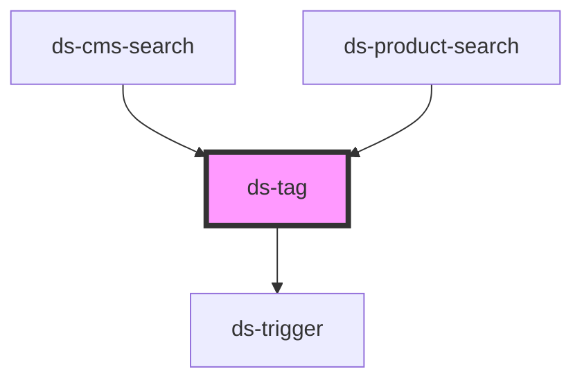

# ds-tag

<!-- Auto Generated Below -->

## Properties

| Property | Attribute | Description | Type     | Default     |
| -------- | --------- | ----------- | -------- | ----------- |
| `tagId`  | `tag-id`  |             | `string` | `undefined` |

## Events

| Event              | Description | Type               |
| ------------------ | ----------- | ------------------ |
| `requestDeleteTag` |             | `CustomEvent<any>` |

## Dependencies

### Used by

 - [ds-cms-search](cms)
 - [ds-product-search](product)

### Depends on

- [ds-trigger](../../../core/trigger)

### Graph

----------------------------------------------

*Built with [StencilJS](https://stenciljs.com/)*
