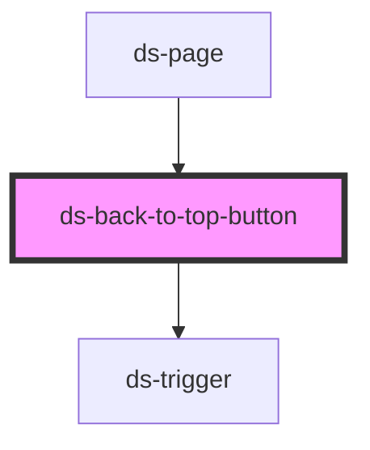

# ds-back-to-top-button

<!-- Auto Generated Below -->

## Properties

| Property         | Attribute         | Description | Type                              | Default     |
| ---------------- | ----------------- | ----------- | --------------------------------- | ----------- |
| `offset`         | `offset`          |             | `number \| string`                | `undefined` |
| `scrollBehavior` | `scroll-behavior` |             | `"auto" \| "instant" \| "smooth"` | `"auto"`    |

## Dependencies

### Used by

 - [ds-page](../page)

### Depends on

- [ds-trigger](../../core/trigger)

### Graph

----------------------------------------------

*Built with [StencilJS](https://stenciljs.com/)*
