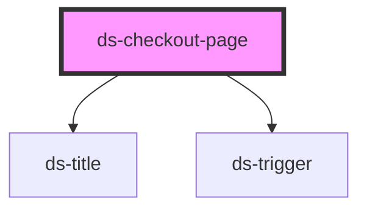

# ds-checkout-page

<!-- Auto Generated Below -->

## Properties

| Property         | Attribute          | Description | Type                 | Default |
| ---------------- | ------------------ | ----------- | -------------------- | ------- |
| `mods`           | `mods`             |             | `string \| string[]` | `""`    |
| `showBackButton` | `show-back-button` |             | `boolean`            | `false` |

## Events

| Event       | Description | Type               |
| ----------- | ----------- | ------------------ |
| `panelShow` |             | `CustomEvent<any>` |

## Dependencies

### Depends on

- [ds-title](../../../core/title)
- [ds-trigger](../../../core/trigger)

### Graph

----------------------------------------------

*Built with [StencilJS](https://stenciljs.com/)*
