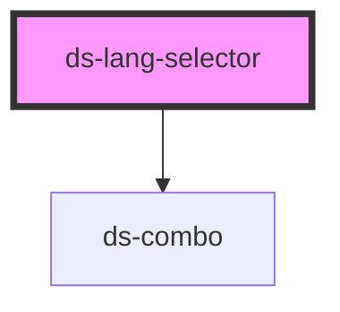

# ds-lang-selector

<!-- Auto Generated Below -->

## Properties

| Property            | Attribute      | Description | Type                   | Default     |
| ------------------- | -------------- | ----------- | ---------------------- | ----------- |
| `currentLang`       | `current-lang` |             | `string`               | `undefined` |
| `languagesFromProp` | `languages`    |             | `DSOption[] \| string` | `[]`        |

## Dependencies

### Depends on

- [ds-combo](../../ui/combo)

### Graph

----------------------------------------------

*Built with [StencilJS](https://stenciljs.com/)*
