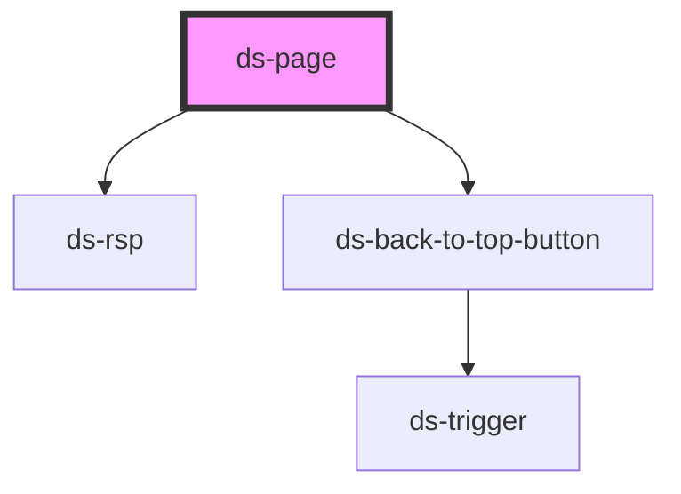

# ds-page

<!-- Auto Generated Below -->

## Properties

| Property  | Attribute  | Description | Type                           | Default        |
| --------- | ---------- | ----------- | ------------------------------ | -------------- |
| `cartUrl` | `cart-url` |             | `string`                       | `undefined`    |
| `locale`  | `locale`   |             | `AppLocale.EN \| AppLocale.FR` | `AppLocale.FR` |
| `mods`    | `mods`     |             | `string \| string[]`           | `""`           |
| `token`   | `token`    |             | `string`                       | `""`           |

## Methods

### `addToCart(id: string, attributeId: string, attributeGroupId: string, customizationId: string) => Promise<void>`

#### Parameters

| Name               | Type     | Description |
| ------------------ | -------- | ----------- |
| `id`               | `string` |             |
| `attributeId`      | `string` |             |
| `attributeGroupId` | `string` |             |
| `customizationId`  | `string` |             |

#### Returns

Type: `Promise<void>`

### `disableScroll() => Promise<void>`

#### Returns

Type: `Promise<void>`

### `enableScroll() => Promise<void>`

#### Returns

Type: `Promise<void>`

### `goTo(url: string) => Promise<void>`

#### Parameters

| Name  | Type     | Description |
| ----- | -------- | ----------- |
| `url` | `string` |             |

#### Returns

Type: `Promise<void>`

## Dependencies

### Depends on

- [ds-rsp](../../core/responsive)
- [ds-back-to-top-button](../back-to-top-button)

### Graph

----------------------------------------------

*Built with [StencilJS](https://stenciljs.com/)*
