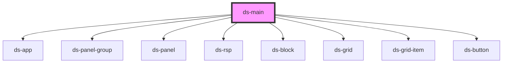

# ds-main

<!-- Auto Generated Below -->

## Methods

### `getData(key: string) => Promise<Record<string, any>>`

#### Returns

Type: `Promise<Record<string, any>>`

## Dependencies

### Depends on

- [ds-app](./core/ds)
- [ds-panel-group](./ui/panel-group)
- [ds-panel](./ui/panel)
- [ds-rsp](./core/ds/responsive)
- [ds-block](./core/block)
- [ds-grid](./core/grid)
- [ds-grid-item](./core/grid/grid-item)
- [ds-button](./ui/button)

### Graph

----------------------------------------------

*Built with [StencilJS](https://stenciljs.com/)*
