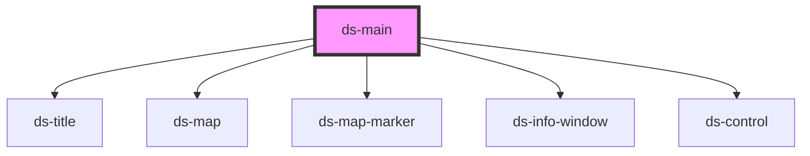

# ds-main

<!-- Auto Generated Below -->

## Methods

### `getData(key: string) => Promise<Record<string, any>>`

#### Returns

Type: `Promise<Record<string, any>>`

## Dependencies

### Depends on

- [ds-title](title)
- [ds-map](map)
- [ds-map-marker](./map/map-marker)
- [ds-info-window](./map/marker-info-window)
- [ds-control](control)

### Graph

----------------------------------------------

*Built with [StencilJS](https://stenciljs.com/)*
