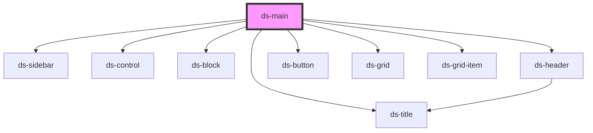

# ds-main

<!-- Auto Generated Below -->

## Methods

### `getData(key: string) => Promise<Record<string, any>>`

#### Returns

Type: `Promise<Record<string, any>>`

## Dependencies

### Depends on

- [ds-sidebar](./ui/sidebar)
- [ds-control](./core/control)
- [ds-block](./core/block)
- [ds-header](./core/header)
- [ds-button](./core/button)
- [ds-title](./core/title)
- [ds-grid](./ui/grid)
- [ds-grid-item](./ui/grid/grid-item)

### Graph

----------------------------------------------

*Built with [StencilJS](https://stenciljs.com/)*
