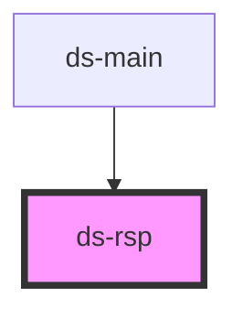

# ds-rsp

<!-- Auto Generated Below -->

## Properties

| Property              | Attribute             | Description | Type                                  | Default                                 |
| --------------------- | --------------------- | ----------- | ------------------------------------- | --------------------------------------- |
| `breakpointsFromProp` | `breakpoints`         |             | `string \| { [x: string]: unknown; }` | `undefined`                             |
| `debounceDelay`       | `debounce-delay`      |             | `number`                              | `200`                                   |
| `propertyName`        | `property-name`       |             | `string`                              | `'data-rsp'`                            |
| `subscriberSelector`  | `subscriber-selector` |             | `string`                              | `'[data-use-rsp]:not([data-rsp-init])'` |

## Methods

### `getData() => Promise<{ breakpoints: Breakpoint[]; }>`

#### Returns

Type: `Promise<{ breakpoints: Breakpoint[]; }>`

### `getSubscribers() => Promise<Element[]>`

#### Returns

Type: `Promise<Element[]>`

### `subscribe(target: Element) => Promise<number>`

#### Returns

Type: `Promise<number>`

## Dependencies

### Used by

 - [ds-main](../../..)

### Graph

----------------------------------------------

*Built with [StencilJS](https://stenciljs.com/)*
