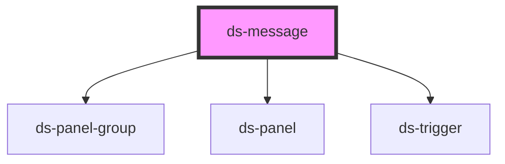

# ds-message

<!-- Auto Generated Below -->

## Properties

| Property  | Attribute  | Description | Type     | Default     |
| --------- | ---------- | ----------- | -------- | ----------- |
| `bgColor` | `bg-color` |             | `string` | `undefined` |
| `color`   | `color`    |             | `string` | `undefined` |
| `speed`   | `speed`    |             | `number` | `undefined` |

## Dependencies

### Depends on

- [ds-panel-group](../panel-group)
- [ds-panel](../panel)
- [ds-trigger](../../core/trigger)

### Graph

----------------------------------------------

*Built with [StencilJS](https://stenciljs.com/)*
