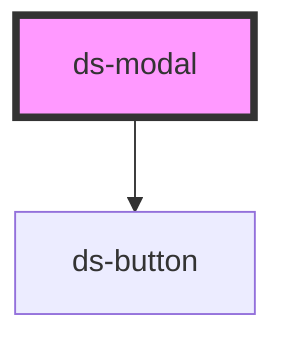

# ds-modal

<!-- Auto Generated Below -->

## Properties

| Property                 | Attribute                    | Description | Type       | Default                |
| ------------------------ | ---------------------------- | ----------- | ---------- | ---------------------- |
| `closeButtonMods`        | --                           |             | `string[]` | `["modal-close"]`      |
| `darkBackground`         | `dark-background`            |             | `boolean`  | `false`                |
| `isClosingDisabled`      | `is-closing-disabled`        |             | `boolean`  | `false`                |
| `isFooterDisabled`       | `is-footer-disabled`         |             | `boolean`  | `false`                |
| `isHeaderDisabled`       | `is-header-disabled`         |             | `boolean`  | `false`                |
| `isLayoutDisabled`       | `is-layout-disabled`         |             | `boolean`  | `false`                |
| `isSubtitleDisabled`     | `is-subtitle-disabled`       |             | `boolean`  | `false`                |
| `lightboxClass`          | `lightbox-class`             |             | `any`      | `{ "--dialog": true }` |
| `lightboxClassObject`    | `lightbox-class-object`      |             | `any`      | `undefined`            |
| `overlay`                | `overlay`                    |             | `boolean`  | `false`                |
| `redirectToOnClose` | `redirect-to-pronto-on-close` |             | `boolean`  | `false`                |
| `shown`                  | `shown`                      |             | `boolean`  | `false`                |
| `useSnack`               | `use-pronto`                  |             | `boolean`  | `false`                |

## Events

| Event        | Description | Type               |
| ------------ | ----------- | ------------------ |
| `modalClose` |             | `CustomEvent<any>` |
| `modalOpen`  |             | `CustomEvent<any>` |

## Dependencies

### Depends on

- [ds-button](../../core/button)

### Graph

----------------------------------------------

*Built with [StencilJS](https://stenciljs.com/)*
