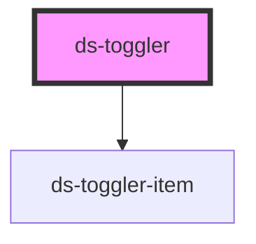

# ds-toggler

<!-- Auto Generated Below -->

## Properties

| Property      | Attribute      | Description | Type      | Default |
| ------------- | -------------- | ----------- | --------- | ------- |
| `isActive`    | `active`       |             | `boolean` | `true`  |
| `items`       | --             |             | `any[]`   | `[]`    |
| `togglerMods` | `toggler-mods` |             | `string`  | `""`    |

## Dependencies

### Depends on

- [ds-toggler-item](toggler-item)

### Graph

----------------------------------------------

*Built with [StencilJS](https://stenciljs.com/)*
