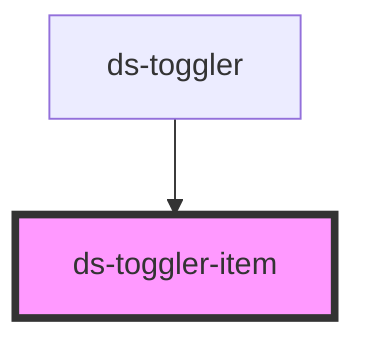

# ds-toggler-item

<!-- Auto Generated Below -->

## Properties

| Property                | Attribute                 | Description | Type      | Default     |
| ----------------------- | ------------------------- | ----------- | --------- | ----------- |
| `expanded`              | `expanded`                |             | `boolean` | `false`     |
| `hasContent`            | `has-content`             |             | `boolean` | `true`      |
| `replaceExtendFunction` | `replace-extend-function` |             | `any`     | `undefined` |
| `titleContent`          | `title-content`           |             | `string`  | `""`        |
| `titleLevel`            | `title-level`             |             | `string`  | `"4"`       |

## Events

| Event                           | Description | Type               |
| ------------------------------- | ----------- | ------------------ |
| `notify_togglerCollapsed_event` |             | `CustomEvent<any>` |
| `notify_togglerExpanded_event`  |             | `CustomEvent<any>` |

## Dependencies

### Used by

 - [ds-toggler](..)

### Graph

----------------------------------------------

*Built with [StencilJS](https://stenciljs.com/)*
