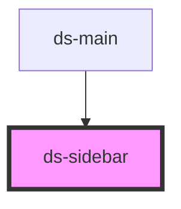

# ds-sidebar

<!-- Auto Generated Below -->

## Properties

| Property   | Attribute  | Description | Type                 | Default                  |
| ---------- | ---------- | ----------- | -------------------- | ------------------------ |
| `ctx`      | `ctx`      |             | `boolean`            | `true`                   |
| `isShown`  | `is-shown` |             | `boolean`            | `false`                  |
| `mods`     | `mods`     |             | `string \| string[]` | `""`                     |
| `position` | `position` |             | `string`             | `SIDEBAR_POSITION.RIGHT` |

## Events

| Event           | Description | Type               |
| --------------- | ----------- | ------------------ |
| `sidebarHidden` |             | `CustomEvent<any>` |
| `sidebarHide`   |             | `CustomEvent<any>` |
| `sidebarShow`   |             | `CustomEvent<any>` |
| `sidebarShown`  |             | `CustomEvent<any>` |

## Methods

### `hide() => Promise<void>`

#### Returns

Type: `Promise<void>`

### `show() => Promise<void>`

#### Returns

Type: `Promise<void>`

### `toggle(mustShow: boolean) => Promise<void>`

#### Returns

Type: `Promise<void>`

## Dependencies

### Used by

 - [ds-main](../..)

### Graph

----------------------------------------------

*Built with [StencilJS](https://stenciljs.com/)*
