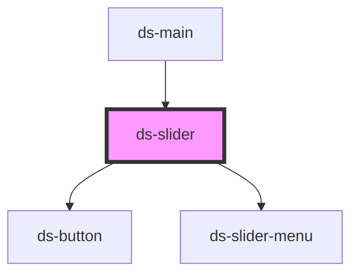

# ds-slider

<!-- Auto Generated Below -->

## Properties

| Property   | Attribute   | Description | Type                      | Default     |
| ---------- | ----------- | ----------- | ------------------------- | ----------- |
| `dsParams` | `ds-params` |             | `DSSliderPrams \| string` | `{}`        |
| `mods`     | `mods`      |             | `string \| string[]`      | `[]`        |
| `sliderId` | `slider-id` |             | `string`                  | `undefined` |
| `type`     | `type`      |             | `string`                  | `"sld"`     |

## Events

| Event           | Description | Type               |
| --------------- | ----------- | ------------------ |
| `dsSliderEvent` |             | `CustomEvent<any>` |

## Methods

### `next(step?: number) => Promise<void>`

#### Returns

Type: `Promise<void>`

## Dependencies

### Used by

 - [ds-main](../..)

### Depends on

- [ds-button](../button)
- [ds-slider-menu](slider-menu)

### Graph

----------------------------------------------

*Built with [StencilJS](https://stenciljs.com/)*
