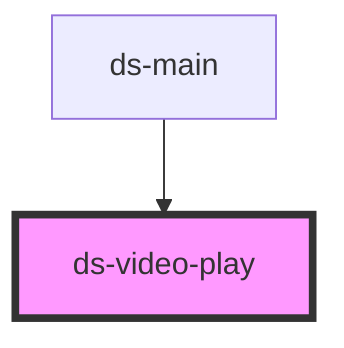

# ds-video-play

<!-- Auto Generated Below -->

## Properties

| Property   | Attribute  | Description | Type                | Default     |
| ---------- | ---------- | ----------- | ------------------- | ----------- |
| `disabled` | `disabled` |             | `boolean \| string` | `false`     |
| `target`   | `target`   |             | `string`            | `undefined` |

## Dependencies

### Used by

 - [ds-main](../../../..)

### Graph

----------------------------------------------

*Built with [StencilJS](https://stenciljs.com/)*
