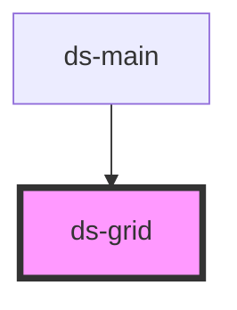

# ds-grid

<!-- Auto Generated Below -->

## Properties

| Property      | Attribute       | Description | Type                           | Default     |
| ------------- | --------------- | ----------- | ------------------------------ | ----------- |
| `dsAlign`     | `ds-align`      |             | `"center" \| "end" \| "start"` | `undefined` |
| `dsCellRatio` | `ds-cell-ratio` |             | `number \| string`             | `undefined` |
| `dsCols`      | `ds-cols`       |             | `number \| string`             | `1`         |
| `dsHGap`      | `ds-h-gap`      |             | `number \| string`             | `1`         |
| `dsMods`      | `ds-mods`       |             | `string \| string[]`           | `[]`        |
| `dsParams`    | --              |             | `{ [x: string]: unknown; }`    | `{}`        |
| `dsType`      | `ds-type`       |             | `"fixed" \| "fluid"`           | `undefined` |
| `dsVAlign`    | `ds-v-align`    |             | `"center" \| "end" \| "start"` | `undefined` |
| `dsVGap`      | `ds-v-gap`      |             | `number \| string`             | `1`         |

## Dependencies

### Used by

 - [ds-main](../..)

### Graph

----------------------------------------------

*Built with [StencilJS](https://stenciljs.com/)*
