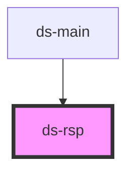

# ds-rsp

<!-- Auto Generated Below -->

## Properties

| Property        | Attribute        | Description | Type     | Default |
| --------------- | ---------------- | ----------- | -------- | ------- |
| `debounceDelay` | `debounce-delay` |             | `number` | `200`   |

## Dependencies

### Used by

 - [ds-main](..)

### Graph

----------------------------------------------

*Built with [StencilJS](https://stenciljs.com/)*
