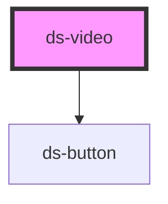

# ds-video

<!-- Auto Generated Below -->

## Properties

| Property   | Attribute  | Description | Type                 | Default     |
| ---------- | ---------- | ----------- | -------------------- | ----------- |
| `autoplay` | `autoplay` |             | `boolean \| string`  | `false`     |
| `controls` | `controls` |             | `boolean \| string`  | `false`     |
| `mods`     | `mods`     |             | `string \| string[]` | `[]`        |
| `poster`   | `poster`   |             | `string`             | `undefined` |
| `sources`  | `sources`  |             | `string \| string[]` | `[]`        |

## Methods

### `mute() => Promise<void>`

#### Returns

Type: `Promise<void>`

### `pause() => Promise<void>`

#### Returns

Type: `Promise<void>`

### `play() => Promise<void>`

#### Returns

Type: `Promise<void>`

### `stop() => Promise<void>`

#### Returns

Type: `Promise<void>`

### `unmute() => Promise<void>`

#### Returns

Type: `Promise<void>`

## Dependencies

### Depends on

- [ds-button](../button)

### Graph

----------------------------------------------

*Built with [StencilJS](https://stenciljs.com/)*
