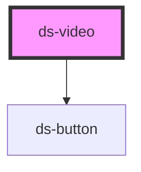

# ds-video

<!-- Auto Generated Below -->

## Properties

| Property        | Attribute         | Description | Type                 | Default     |
| --------------- | ----------------- | ----------- | -------------------- | ----------- |
| `dsAutoplay`    | `ds-autoplay`     |             | `boolean \| string`  | `false`     |
| `dsMods`        | `ds-mods`         |             | `string \| string[]` | `[]`        |
| `dsPoster`      | `ds-poster`       |             | `string`             | `undefined` |
| `dsSources`     | `ds-sources`      |             | `string \| string[]` | `[]`        |
| `dsUseControls` | `ds-use-controls` |             | `boolean \| string`  | `false`     |

## Dependencies

### Depends on

- [ds-button](../button)

### Graph

----------------------------------------------

*Built with [StencilJS](https://stenciljs.com/)*
