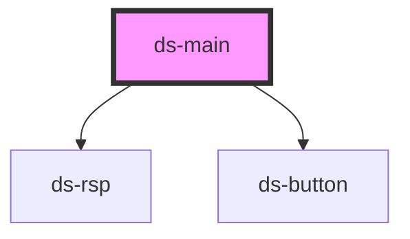

# ds-main

<!-- Auto Generated Below -->

## Methods

### `getData(key: string) => Promise<Record<string, any>>`

#### Returns

Type: `Promise<Record<string, any>>`

## Dependencies

### Depends on

- [ds-rsp](./components/ui/responsive)
- [ds-button](./components/ui/button)

### Graph

----------------------------------------------

*Built with [StencilJS](https://stenciljs.com/)*
